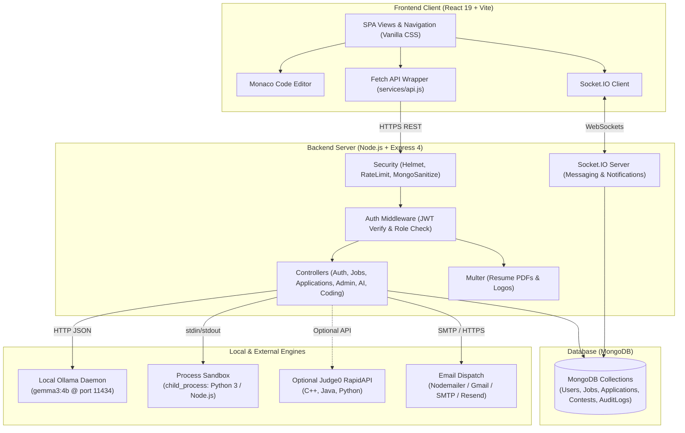

# CareerPilot AI — Smart Placement Preparation & Recruitment Platform

[](https://react.dev/)
[](https://vitejs.dev/)
[](https://nodejs.org/)
[](https://www.mongodb.com/)
[-orange.svg)](https://ollama.com/)
[](LICENSE)

CareerPilot AI is a production-grade, full-stack recruitment and career preparation ecosystem built on the **MERN** stack (MongoDB, Express.js, React, Node.js). It unifies job discovery, application pipeline management, and placement preparation into a cohesive platform. 

Powered locally by **Ollama (`gemma3:4b`)**, CareerPilot AI provides candidates with automated resume ATS scoring, personalized vertical career roadmaps, structured placement quizzes, AI-driven mock interviews, and sandboxed coding challenges—all while giving recruiters and administrators corporate-grade tools to manage listings, evaluate applicants, schedule interviews, and communicate in real time.

---

## Table of Contents

1. [About CareerPilot AI](#1-about-careerpilot-ai)
2. [Problem and Solution](#2-problem-and-solution)
3. [Key Features](#3-key-features)
   - [Candidate & Student Features](#candidate--student-features)
   - [Admin & Recruiter Features](#admin--recruiter-features)
   - [Email Notification System](#email-notification-system)
4. [Technology Stack](#4-technology-stack)
5. [Application Architecture](#5-application-architecture)
6. [Main Workflows](#6-main-workflows)
7. [Project Structure](#7-project-structure)
8. [Prerequisites and Local Setup](#8-prerequisites-and-local-setup)
9. [Environment Configuration](#9-environment-configuration)
10. [Authentication, Roles, and Security](#10-authentication-roles-and-security)
11. [Testing and Troubleshooting](#11-testing-and-troubleshooting)
12. [Deployment Considerations](#12-deployment-considerations)
13. [Credits and Acknowledgements](#13-credits-and-acknowledgements)

---

## 1. About CareerPilot AI

CareerPilot AI bridges the gap between searching for a job and actively preparing for it. Traditional recruitment portals focus solely on listing vacancies, leaving applicants to search elsewhere for interview practice, resume feedback, and technical preparation.

CareerPilot AI serves three primary user personas:
- **Students & Job Seekers (`candidate`)**: Discover verified jobs, submit applications with parsed PDF resumes, analyze skill gaps, generate custom learning roadmaps, practice technical and behavioral mock interviews with instant AI feedback, and write code in a sandboxed IDE.
- **Recruiters (`recruiter`)**: Post and manage job listings, track candidate pipelines across multiple hiring stages, inspect parsed resumes, record private evaluation notes, and chat directly with applicants.
- **Platform Administrators (`admin`)**: Maintain full administrative control over all jobs, moderate user accounts, manage application workflows with interview scheduling and automated corporate status emails, oversee AI question banks and coding problem catalogs, and inspect system audit logs.

---

## 2. Problem and Solution

### The Problem
- **Fragmented Preparation**: Candidates jump between disconnected websites for job boards, LeetCode-style algorithm practice, resume checkers, and mock interview guides.
- **Opaque Application Pipelines**: Applicants submit resumes into a "black hole" with no visibility into evaluation progress, stages, or actionable feedback.
- **Manual Recruiter Overhead**: Hiring teams juggle email inboxes, spreadsheets, and calendar apps to schedule rounds and communicate status updates.
- **Costly Cloud AI Dependencies**: Most modern AI-enhanced tools incur expensive recurring API charges and send sensitive student resume data to external cloud providers.

### The Solution
CareerPilot AI consolidates the entire journey into a single platform:
- **Unified Workspace**: Job hunting, ATS resume evaluation, custom roadmap generation, quizzes, coding sandbox, and live interview scheduling live under one roof.
- **Transparent Lifecycle Tracking**: Candidates track applications in real time through six explicit stages (`Applied`, `Under Review`, `Shortlisted`, `Interview Scheduled`, `Rejected`, `Hired`) with in-app notifications and corporate email notifications.
- **Recruiter Efficiency**: Admins and recruiters manage candidates from interactive dashboards, schedule interviews via an interactive calendar modal, and trigger corporate-formatted emails with a single click.
- **Private, Zero-Cost Local AI**: Powered locally by **Ollama (`gemma3:4b`)**, all resume scoring, career roadmaps, interview evaluations, and chatbot interactions run directly on the host machine—100% free, private, and offline-capable without external API keys.

---

## 3. Key Features

### Candidate & Student Features

#### 1. Job Discovery & Applications
- **Faceted Job Search**: Filter verified listings by title, keywords, location, employment type (Full-time, Part-time, Remote, Internship, Contract), and salary range.
- **One-Click Application**: Apply with an uploaded PDF resume, cover letter notes, and profile details.
- **Bookmark & Saved Jobs**: Save interesting job postings to revisit or apply for later.

#### 2. Application Pipeline Tracking (`/my-applications`)
- **Stage Progression Tracker**: Visual status timeline tracking applications through `Applied`, `Under Review`, `Shortlisted`, `Interview Scheduled`, `Rejected`, and `Hired`.
- **Interview Details Viewer**: Once an interview is scheduled, applicants immediately see the confirmed date, time, timezone, meeting link (Google Meet, Zoom, Teams), and preparation notes directly on their application card.
- **Recruiter Feedback**: Read notes, interview updates, and feedback provided by the hiring team.

#### 3. AI Placement Prep Hub (`/ai-preparation`)
*(Student-facing preparation suite; admins have preview access to review content)*
- **ATS Resume Analyzer**: Upload a PDF resume to extract text via `pdf-parse` and receive an instant ATS compatibility score (0–100%), strengths summary, missing keywords, and concrete bullet-point improvements generated by Gemma 3.
- **Vertical Career Roadmap Generator**: Generate structured week-by-week learning timelines tailored to target role, current experience level, and preferred language/stack. Roadmaps can be saved to the database and accessed anytime.
- **Placement Quizzes with Database Persistence**: Test conceptual knowledge across JavaScript, React, and Node.js. Completed quiz attempts, answer selections, scores, and accuracy percentages are saved to the candidate's profile.
- **AI Mock Interview Simulator**: Generate 10 curated questions across Technical, HR/Behavioral, and Resume domains. Candidates type responses into the interactive evaluator to receive instant 1–10 scoring, constructive critique, and STAR-method suggestions powered by Gemma 3.

#### 4. CareerPilot AI Placement Chatbot (`/ai-chat`)
- **Interactive Multi-Turn Mentor**: Conversational placement assistant powered by local `gemma3:4b`.
- **Pre-Configured Placement Prompt Pills**:
  - *Data Structures & Algorithms* guidance
  - *HR & Behavioral Interview* rehearsal
  - *Resume Bullet Point Optimization*
  - *System Design & Architecture* review
- **Persisted Thread History**: Chat sessions are saved per candidate, supporting multiple conversation threads, markdown rendering, and code copying.
- **Floating Widget (`AIFloatingChat`)**: Accessible across all pages for quick on-the-fly placement questions.

#### 5. Sandboxed Coding Practice (`/coding`)
- **Problem Directory**: Filter coding challenges by Difficulty (`Easy`, `Medium`, `Hard`), Category (`Arrays`, `Strings`, `Dynamic Programming`, `Trees`, etc.), and Solved status.
- **Monaco Code Editor**: Professional `vs-dark` editor with syntax highlighting, auto-indentation, and starter templates for Python 3 and JavaScript.
- **Dual Execution Sandbox**:
  - Built-in local child process sandbox executing Python 3 and Node.js with strict execution timeouts (default 3 seconds), memory safeguards, and stdin piping.
  - Optional Judge0 CE RapidAPI fallback supporting C++ and Java when API keys are configured.
- **Test Case Validation**: Run sample test cases against custom input or submit code against hidden evaluation test cases to receive instant verdicts (`Accepted`, `Wrong Answer`, `Time Limit Exceeded`, `Runtime Error`).
- **Submission History**: Track verdict, runtime memory, execution time, and past solution code.

#### 6. Timed Coding Contests (`/contests`)
- **Automated Lifecycle**: Contests automatically transition between `upcoming`, `active`, and `ended` states based on server timestamps.
- **Registration Gate**: Candidates register prior to contest launch.
- **Synchronized Arena**: Real-time countdown timer, problem selection tabs, and code submission runner.
- **ICPC Live Leaderboard**: Dynamic ranking calculated using problem scores and penalty minutes based on submission timestamps and failed attempts.

#### 7. Real-Time Chat & In-App Notifications
- **1-to-1 Candidate-Recruiter Messaging**: Direct chat with recruiters and admins powered by WebSockets (`Socket.IO`).
- **Notification Center (`NotificationCenter.jsx`)**: In-app bell dropdown with unread badge counters, instant push updates for new chat messages, application status changes, and interview invitations.

---

### Admin & Recruiter Features

| Feature | Recruiter (`recruiter`) | Admin (`admin`) |
| :--- | :---: | :---: |
| Post, edit, close, and reopen job listings | ✅ (Own jobs) | ✅ (All jobs) |
| Delete job listings | ✅ (Own jobs) | ✅ (All jobs) |
| Company logo upload | ✅ | ✅ |
| Review applicants and inspect parsed resumes | ✅ (Own jobs) | ✅ (All jobs) |
| Advance candidate application status | ✅ | ✅ |
| Schedule interviews with calendar modal & corporate emails | ✅ | ✅ |
| Inline candidate chat drawer | ❌ (Full page chat) | ✅ (On dashboard) |
| Moderate student accounts (Suspend / Reactivate) | ❌ | ✅ |
| Manage AI Prep Hub quiz questions | ❌ | ✅ |
| Manage Code Practice DSA problems | ❌ | ✅ |
| View recruitment analytics & conversion metrics | ✅ | ✅ |
| Immutable system audit log inspection | ❌ | ✅ |
| Preview student AI Prep Hub & Coding Practice | ✅ | ✅ |

#### Key Administrative Highlights
- **Interview Scheduling Calendar**: When setting an application to `Interview Scheduled`, admins and recruiters use an interactive modal featuring a date picker, quick time slot chips, timezone selector, video platform dropdown (Google Meet, Zoom, Microsoft Teams), meeting URL, and round notes.
- **Inline Candidate Chat Drawer**: Admins can open a slide-over chat drawer directly from the application table on `/admin/dashboard` to communicate with applicants instantly without losing context.
- **Immutable Audit Logging**: Every administrative action (job creation/deletion, status change, user suspension, content edit) is logged to the database with the admin's email, target ID, action description, and client IP address.

---

### Email Notification System

CareerPilot AI integrates a multi-provider email service (`server/utils/sendEmail.js` and `server/utils/statusEmailTemplates.js`) that sends executive-grade, responsive HTML emails for critical events:

1. **Authentication & Security**:
   - **Password Recovery**: Secure password reset email containing a time-limited (10-minute) cryptographic token link (`/reset-password/:token`).
2. **Candidate Selection Pipeline Updates**:
   - **`Under Review`**: Formal acknowledgement that the candidate's application is actively being evaluated by hiring managers.
   - **`Shortlisted`**: Congratulatory notice advancing the candidate to the next round, recommending the AI Prep Hub for interview practice.
   - **`Interview Scheduled`**: Executive interview invitation containing the scheduled date, time, timezone, video platform, meeting link, and round preparation notes.
   - **`Rejected`**: Empathetic, polite corporate regret letter expressing appreciation for the applicant's time and encouraging future applications.
   - **`Hired`**: Official congratulatory offer notice outlining next onboarding steps.
3. **Multi-Provider Dispatch Architecture**:
   - **Gmail SMTP**: Works out-of-the-box using a standard Google 16-character App Password.
   - **Custom SMTP**: Integrates with enterprise relays such as Brevo, SendGrid, Amazon SES, or Mailgun.
   - **Resend HTTP API**: Direct HTTPS delivery via Resend API key to bypass port restrictions.
   - **Console Dev Fallback**: If no email credentials are configured in `.env`, the server automatically logs simulated email payloads to the console without crashing or throwing errors.

---

## 4. Technology Stack

### Frontend Client
| Technology | Version | Purpose |
| :--- | :--- | :--- |
| **React** | `^19.2.6` | Core component-based user interface library |
| **Vite** | `^8.0.12` | High-performance build tool and local dev server |
| **Monaco Editor** | `^4.7.0` | In-browser VS Code editing experience for coding practice |
| **Lucide React** | `^1.17.0` | Consistent, lightweight SVG iconography |
| **Recharts** | `^3.8.1` | Interactive charts for recruitment analytics and candidate metrics |
| **Socket.io-client** | `^4.8.3` | Real-time WebSocket connection for chat and instant notifications |
| **Vanilla CSS** | Modern CSS3 | Custom design system with glassmorphism, responsive grids, and dark mode |

### Backend API Server
| Technology | Version | Purpose |
| :--- | :--- | :--- |
| **Node.js** | `>= 18.0.0` | Server-side JavaScript runtime environment |
| **Express.js** | `^4.19.2` | RESTful API routing, controllers, and middleware framework |
| **MongoDB & Mongoose** | `^8.3.1` | NoSQL document database and ODM with schema validation and indexing |
| **Socket.IO** | `^4.8.3` | WebSocket server for bidirectional chat and live notification dispatch |
| **Nodemailer** | `^8.0.10` | SMTP email transport client for transactional and status notifications |
| **Multer** | `^2.1.1` | Multipart form-data middleware for PDF resume and image uploads |
| **pdf-parse** | `^2.4.5` | Server-side PDF text extraction for automated ATS resume analysis |
| **bcryptjs** | `^3.0.3` | Salted password hashing (10 rounds) |
| **jsonwebtoken** | `^9.0.3` | Stateless JWT token generation and authentication verification |
| **Helmet** | `^8.2.0` | HTTP response header security hardening |
| **express-rate-limit** | `^8.5.2` | IP-based rate limiting to prevent brute-force attacks |
| **express-validator** | `^7.3.2` | Request body validation and sanitization |

### AI Model & Sandboxed Execution
| Technology | Type | Purpose |
| :--- | :--- | :--- |
| **Ollama (`gemma3:4b`)** | Local LLM | Primary AI engine running locally at `http://127.0.0.1:11434` for resume ATS scoring, roadmaps, quizzes, interview feedback, and chatbot |
| **Child Process Sandbox** | Local Sandbox | Built-in Node.js isolated execution with strict timeouts for Python 3 and JavaScript |
| **Judge0 CE (RapidAPI)** | External API | Optional fallback code execution engine supporting C++, Java, Python, and Node.js |
| **Google GenAI SDK** | External SDK | Optional cloud fallback via `@google/genai` if configured |

---

## 5. Application Architecture



### Request and Data Flow
1. **Authentication Flow**: The client transmits login credentials via `POST /api/auth/login`. The controller verifies the salted password using `bcryptjs` and signs a stateless JWT containing the user ID and role (`candidate`, `recruiter`, `admin`). Subsequent requests attach `Authorization: Bearer <token>`.
2. **AI Inference Flow**: When a user analyzes a resume or submits an interview answer, the backend constructs a structured prompt, enforces JSON formatting (`format: 'json'`), and dispatches it to the local Ollama daemon (`POST /api/chat`). The parsed JSON response is validated and returned to the client without calling external cloud servers.
3. **Code Execution Flow**: Coding solutions from the Monaco Editor are sent to `POST /api/coding/run` or `POST /api/coding/submit`. The service writes the code to a temporary file, spawns a sandboxed `python` or `node` child process, pipes stdin test cases, monitors execution against a 3-second watchdog timer, and returns structured execution metrics (time, memory, stdout, stderr, verdict).
4. **Interview Scheduling & Email Flow**: When an admin/recruiter schedules an interview, the backend updates the application record, creates an `Interview` entry, generates an executive-grade HTML email via `statusEmailTemplates.js`, dispatches it asynchronously via `sendEmail.js`, and pushes an in-app notification to the candidate via `Socket.IO`.

---

## 6. Main Workflows

### 1. User Registration & Onboarding
1. A new user accesses `/signup` and chooses between **Candidate** or **Recruiter** role.
2. The user completes their profile: candidates upload an initial PDF resume and declare target skills; recruiters enter their company details and website.
3. The platform provisioned administrator (`admin@gmail.com`) can log in directly at `/login` to access the super-admin console.

### 2. Job Application Workflow
1. A candidate browses listings on `/jobs`, filters by criteria, and clicks **Apply Now**.
2. An application modal appears: the candidate uploads their latest PDF resume and adds optional cover notes.
3. The backend stores the file in `server/uploads/`, extracts text using `pdf-parse`, and creates an `Application` record linked to the job and candidate.
4. The candidate tracks the application in real time on `/my-applications`.

### 3. Student Placement Preparation Workflow
1. **Resume Audit**: The student uploads a resume on `/ai-preparation`. Ollama scans the text and produces an ATS compatibility report with missing keywords.
2. **Career Roadmap**: The student enters their target role (e.g., "Full Stack Developer") and experience level. Gemma 3 generates a custom 12-week roadmap that the student can save to their profile.
3. **Topic Quizzes**: The student takes timed multiple-choice quizzes in JavaScript, React, or Node.js. Results and accuracy metrics are persisted to the database.
4. **Mock Interview Simulation**: The student generates 10 targeted interview questions. For each question, they type their response. Gemma 3 evaluates clarity, technical accuracy, and STAR-method alignment, scoring each answer from 1 to 10.
5. **Sandboxed Coding Practice**: The student selects a problem from `/coding`, writes solution code in Python 3 or JavaScript within the Monaco Editor, and executes it against test cases.

### 4. Admin Application Review & Stage Progression
1. The administrator navigates to `/admin/dashboard` and views the unified applications table.
2. The admin filters by job or status, inspects candidate details, and reviews the uploaded resume.
3. The admin changes the status dropdown (e.g., from `Applied` to `Under Review` or `Shortlisted`).
4. The system automatically records an audit log, saves the new status, dispatches a status notification email to the candidate, and sends an in-app alert.

### 5. Interview Scheduling Workflow
1. On the Admin Dashboard or Recruiter Dashboard, the manager selects **Interview Scheduled** for a candidate.
2. The **Interview Scheduling Modal** opens:
   - Select date via interactive calendar.
   - Choose time slot chips (e.g., `10:00 AM`, `02:30 PM`, `04:00 PM`) and timezone (`IST`, `EST`, `PST`, `UTC`).
   - Select video platform (`Google Meet`, `Zoom`, `Microsoft Teams`).
   - Enter meeting URL and round instructions.
3. Clicking **Schedule & Notify Candidate** saves the interview record, updates application status, pushes an in-app notification, and dispatches a corporate interview invitation email containing calendar metadata.

### 6. Real-Time Chat & Bidirectional Notifications
1. An admin clicks the **Chat** icon next to an applicant on the dashboard to open the inline chat drawer.
2. Messages sent through the drawer are broadcast over WebSockets via `Socket.IO`.
3. If the recipient is active, the message appears instantly in their chat window; simultaneously, an in-app notification with an unread badge is delivered to their notification center.

---

## 7. Project Structure

```text
job123-main/
├── README.md                      # Complete project documentation
├── package.json                   # Root metadata (if configured)
│
├── client/                        # React 19 + Vite Frontend Client
│   ├── package.json               # Frontend dependencies & scripts
│   ├── vite.config.js             # Vite configuration
│   ├── index.html                 # Single Page Application HTML entry
│   └── src/
│       ├── main.jsx               # Application bootstrap
│       ├── App.jsx                # Client-side router, auth state, socket listener
│       ├── index.css              # Unified CSS design system (Dark mode & glassmorphism)
│       ├── components/            # Reusable UI components
│       │   ├── Navbar.jsx         # Navigation bar with role tabs & theme toggle
│       │   ├── NotificationCenter.jsx # Real-time notification dropdown & badge
│       │   ├── AIFloatingChat.jsx # Global floating AI mentor widget
│       │   ├── ApplyModal.jsx     # Job application & PDF upload modal
│       │   ├── JobCard.jsx        # Job listing card component
│       │   ├── Modal.jsx          # Reusable accessible dialog overlay
│       │   └── LoadingSpinner.jsx # Modern SVG loading indicator
│       ├── pages/                 # Full-page views
│       │   ├── Home.jsx           # Landing page with search banner & highlights
│       │   ├── Jobs.jsx           # Filterable job board
│       │   ├── JobDetails.jsx     # Detailed job overview & apply button
│       │   ├── CandidateDashboard.jsx # Student dashboard & prep shortcuts
│       │   ├── MyApplications.jsx # Application stage tracker & interview viewer
│       │   ├── AIPreparation.jsx  # AI Prep Hub (ATS, Roadmaps, Quizzes, Mock Interviews)
│       │   ├── AIChat.jsx         # Dedicated full-page Gemma 3 placement chatbot
│       │   ├── CodingPractice.jsx # Sandboxed code practice with Monaco Editor
│       │   ├── Contests.jsx       # Timed coding contests & ICPC leaderboard
│       │   ├── AdminDashboard.jsx # Super-admin operations & calendar scheduler
│       │   ├── RecruiterDashboard.jsx # Recruiter job management & applicant review
│       │   ├── RecruiterAnalytics.jsx # Hiring pipeline funnel & conversion metrics
│       │   ├── Chat.jsx           # Real-time 1-to-1 messaging page
│       │   ├── Profile.jsx        # User profile, skills, education, saved roadmaps
│       │   ├── Login.jsx          # User sign-in
│       │   ├── Signup.jsx         # Role-based sign-up
│       │   ├── ForgotPassword.jsx # Password reset request
│       │   └── ResetPassword.jsx  # Tokenized password reset form
│       └── services/
│           └── api.js             # Unified Fetch client wrapper with JWT injection
│
└── server/                        # Node.js + Express Backend API
    ├── package.json               # Backend dependencies & npm scripts
    ├── server.js                  # Express app, security middlewares, Socket.IO server
    ├── .env.example               # Template environment variables
    ├── config/
    │   └── db.js                  # MongoDB Mongoose connection handler
    ├── models/                    # Mongoose database models (20 schemas)
    │   ├── User.js                # User accounts, credentials, and roles
    │   ├── Job.js                 # Job postings and requirements
    │   ├── Application.js         # Applications, stage status, and interview data
    │   ├── AuditLog.js            # Immutable administrator action logs
    │   ├── Interview.js           # Scheduled interview records
    │   ├── InterviewSession.js    # AI mock interview session data & scores
    │   ├── CodingProblem.js       # DSA coding problems & test cases
    │   ├── CodingSubmission.js    # Candidate code evaluation results
    │   ├── Contest.js             # Timed coding contests
    │   ├── ContestSubmission.js   # Contest submissions & penalty minutes
    │   ├── QuizQuestion.js        # Prep hub question bank
    │   ├── QuizAttempt.js         # Candidate quiz results & accuracy
    │   ├── SavedRoadmap.js        # Saved vertical career roadmaps
    │   ├── Conversation.js        # 1-to-1 chat channel metadata
    │   ├── Message.js             # Chat message entries
    │   └── Notification.js        # In-app user notifications
    ├── middleware/
    │   ├── authMiddleware.js      # JWT Bearer token verification
    │   ├── roleMiddleware.js      # Role authorization (candidate, recruiter, admin)
    │   ├── uploadMiddleware.js    # Multer configuration for PDFs and images
    │   ├── validatorMiddleware.js # Express-validator error handler
    │   └── errorHandler.js       # Centralized JSON error response handler
    ├── controllers/               # Business logic controllers
    │   ├── authController.js      # Login, registration, password recovery
    │   ├── jobController.js       # Job CRUD, bookmarking, and search
    │   ├── applicationController.js # Applying, candidate tracking, status updates
    │   ├── adminController.js     # Admin metrics, audit logs, user & content controls
    │   ├── chatController.js      # Messaging and notification dispatch
    │   ├── aiController.js        # Resume ATS parsing, roadmaps, mock interviews
    │   ├── codingController.js    # Code execution, test runner, submissions
    │   └── contestController.js   # Contest arena, registration, leaderboards
    ├── routes/                    # Express API route definitions
    ├── scripts/
    │   └── initAdmin.js           # Automated admin provisioning CLI script
    ├── utils/                     # Utility services
    │   ├── ollamaService.js       # Local Ollama client (JSON mode & chat)
    │   ├── judge0Service.js       # Local child process sandbox & Judge0 client
    │   ├── resumeParser.js        # PDF text extractor via pdf-parse
    │   ├── sendEmail.js           # Nodemailer / Resend multi-provider dispatcher
    │   ├── statusEmailTemplates.js # Executive corporate HTML email templates
    │   ├── seed.js                # Initial jobs, recruiters, and candidates seed
    │   ├── seed_problems.js       # 15+ Placement DSA problems seed
    │   └── seed_contests.js       # Timed coding contests seed
    ├── scratch/                   # Verification and test scripts
    └── uploads/                   # Local storage for resumes and logos
```

---

## 8. Prerequisites and Local Setup

### System Prerequisites
Before installing, verify your system meets the following requirements:
- **Node.js**: `v18.0.0` or higher (verified on Node `v20.x`)
- **npm**: `v9.0.0` or higher
- **MongoDB**: Community Server running locally on port `27017` (or a remote MongoDB Atlas URI)
- **Ollama**: Installed from [ollama.com](https://ollama.com)
- **Python 3**: Installed and available on your system `PATH` (required for local Python code execution in the coding sandbox)

---

### Step-by-Step Installation

#### 1. Configure and Launch Local AI (Ollama)
In a dedicated terminal window:
```bash
# Pull the Gemma 3 4B-parameter model (approx. 2.5 GB download)
ollama pull gemma3:4b

# Start the local Ollama server (listens on http://127.0.0.1:11434)
ollama serve
```

#### 2. Configure Backend Server (`server/`)
Open a new terminal window:
```bash
# Navigate to backend directory
cd server

# Install dependencies
npm install

# Create environment configuration file from example template
cp .env.example .env
```

Edit `server/.env` with your settings (see [Environment Configuration](#9-environment-configuration) below).

#### 3. Seed Database & Provision Admin Account
Populate default recruitment data, DSA coding challenges, contests, and provision the platform administrator:
```bash
# Seed initial jobs, candidates, and recruiter accounts
npm run seed

# Seed DSA coding problems (Two Sum, Kadane's, Binary Search, etc.)
node utils/seed_problems.js

# Seed timed coding contests
node utils/seed_contests.js

# Provision super-admin account (admin@gmail.com / admin@123!)
npm run setup:admin
```

#### 4. Start the Backend Server
```bash
# Run with nodemon for hot-reload development
npm run dev

# Or run standard production server
npm start
```
The backend API server will start on `http://localhost:5000`.

#### 5. Configure and Start Frontend Client (`client/`)
In a new terminal window:
```bash
# Navigate to frontend directory
cd client

# Install dependencies
npm install

# Start Vite development server
npm run dev
```
The client application will start on `http://localhost:5173`. Open this URL in your web browser.

---

## 9. Environment Configuration

### Backend Environment Variables (`server/.env`)

Configure these values in `server/.env`. A complete template is provided in `server/.env.example`.

| Variable | Required | Default / Example | Purpose |
| :--- | :---: | :--- | :--- |
| `PORT` | No | `5000` | Port for Express server and Socket.IO |
| `MONGODB_URI` | **Yes** | `mongodb://127.0.0.1:27017/jobportal_pro` | MongoDB connection connection string |
| `JWT_SECRET` | **Yes** | `your_jwt_secret_here_min_32_chars` | Secret key used to sign and verify JWT tokens |
| `CLIENT_URL` | No | `http://localhost:5173` | Frontend URL (used in email links and CORS) |
| `OLLAMA_BASE_URL` | No | `http://127.0.0.1:11434` | Endpoint of the running local Ollama daemon |
| `OLLAMA_MODEL` | No | `gemma3:4b` | Ollama model name to invoke for AI operations |
| `EMAIL_SERVICE` | No | `gmail` | Nodemailer service identifier (e.g., `gmail`) |
| `EMAIL_USER` | Optional | `your_email@gmail.com` | SMTP username or Gmail address |
| `EMAIL_PASS` | Optional | `abcd efgh ijkl mnop` | Gmail 16-character App Password or SMTP password |
| `EMAIL_FROM` | No | `"CareerPilot AI <your_email@gmail.com>"` | Friendly sender name and email address |
| `EMAIL_HOST` | Optional | `smtp-relay.brevo.com` | Custom SMTP host (if not using Gmail) |
| `EMAIL_PORT` | Optional | `587` | Custom SMTP port (`587` for TLS, `465` for SSL) |
| `RESEND_API_KEY` | Optional | `re_123456789` | Resend HTTPS API key (alternative to SMTP) |
| `JUDGE0_API_KEY` | Optional | `your_rapidapi_key` | RapidAPI key for Judge0 CE (optional) |
| `JUDGE0_API_HOST` | Optional | `judge0-ce.p.rapidapi.com` | RapidAPI host for Judge0 |
| `ADMIN_EMAIL` | No | `admin@gmail.com` | Default email used by `npm run setup:admin` |
| `ADMIN_PASSWORD` | No | `admin@123!` | Default password used by `npm run setup:admin` |

> [!NOTE]
> **Email Setup Tip**: If `EMAIL_USER` and `EMAIL_PASS` are omitted, the server operates in safe **Dev Mode**: email contents will be printed cleanly to the server terminal, allowing full local testing without real credentials.
>
> To send real emails via Gmail:
> 1. Enable 2-Step Verification in your Google Account.
> 2. Generate an **App Password** at `myaccount.google.com/apppasswords` (select app: *Mail*).
> 3. Paste the 16-character password into `EMAIL_PASS` (spaces are stripped automatically).

---

### Frontend Environment Variables (`client/.env`)

Vite reads environment variables prefixed with `VITE_`. Default fallbacks are built into the source code, but you can create `client/.env` to override them:

| Variable | Required | Default | Purpose |
| :--- | :---: | :--- | :--- |
| `VITE_API_URL` | No | `http://localhost:5000/api` | Base URL for REST API requests |
| `VITE_SOCKET_URL` | No | `http://localhost:5000` | Base URL for the Socket.IO server |

---

## 10. Authentication, Roles, and Security

### Role-Based Access Control (RBAC)
Every user in CareerPilot AI belongs to one of three roles, enforced at both the client route level and via backend route middleware (`protect` and `authorizeRoles`):

```text
       ┌───────────────┐
       │     User      │
       └───────┬───────┘
               │
      ┌────────┼────────┐
      ▼        ▼        ▼
Candidate  Recruiter  Admin
```

- **`candidate`**: Access to job listings, job application submission, personal application pipeline, AI Prep Hub (ATS, roadmaps, quizzes, mock interviews), AI chatbot, coding sandbox, timed contests, and 1-to-1 messaging.
- **`recruiter`**: Access to posting and editing own jobs, reviewing applicants for own jobs, updating applicant statuses, scheduling interviews, and candidate chat.
- **`admin`**: Global system authority. Access to all job listings, all candidate applications, interview scheduling with calendar modal and corporate emails, student account moderation (suspension/reactivation), AI Prep Hub content management, Coding Problem catalog management, and immutable system audit logs.

---

### Security Safeguards Verified in Code
1. **Password Hashing**: User passwords are encrypted using `bcryptjs` with 10 salt rounds before being written to the database. Plaintext passwords are never saved or returned in API responses (`select('-password')`).
2. **Stateless JWT Authentication**: Authenticated sessions issue JSON Web Tokens with a 30-day expiration window. Protected endpoints verify the `Authorization: Bearer <token>` header.
3. **NoSQL Injection Sanitization**: A custom `mongoSanitize` middleware runs on every incoming request, recursively stripping any keys beginning with `$` from `req.body`, `req.query`, and `req.params`.
4. **Rate Limiting**: Configured with `express-rate-limit` to prevent brute-force attacks on API endpoints (10,000 requests per 15 minutes during local development; 1,000 requests per 15 minutes in production).
5. **HTTP Security Headers**: `helmet` is configured to set secure HTTP headers while permitting cross-origin rendering for local uploaded files (`crossOriginResourcePolicy: false`).
6. **Account Suspension Protection**: The `protect` middleware immediately rejects requests from accounts flagged with `isSuspended: true`, preventing banned users from accessing the system.
7. **Secure Password Reset Flow**: Forgot password requests generate a cryptographically random token via `crypto.randomBytes(20)`. The token is hashed with SHA-256 before database storage, given a strict 10-minute expiry, and sent via email.
8. **Sandboxed Code Execution Isolation**: User-submitted code is isolated inside temporary directory files and executed with strict child process execution limits (`SIGKILL` after 3 seconds) and standard I/O buffer caps.

---

## 11. Testing and Troubleshooting

### Verification Commands

```bash
# 1. Verify Frontend Production Build
cd client
npm run build

# 2. Check Frontend Linting
npm run lint

# 3. Seed Database Collections
cd ../server
npm run seed
node utils/seed_problems.js
node utils/seed_contests.js

# 4. Verify Super-Admin Provisioning
npm run setup:admin

# 5. Run Admin Suite Integration Tests
node scratch/test_admin_suite.js

# 6. Run Admin Job Permissions Verification
node scratch/test_admin_job_permissions.js

# 7. Run Status Emails Verification (Live or Simulated)
node scratch/test_status_emails.js

# 8. Run Chat & Real-Time Notifications Test
node scratch/test_chat_notifications.js

# 9. Run AI Mock Interview Simulator Test
node ../scratch/test_interview_simulator.js
```

---

### Common Troubleshooting Scenarios

#### 1. Ollama Connection Refused (`ECONNREFUSED 127.0.0.1:11434`)
- **Cause**: The Ollama daemon is not running on your host machine.
- **Solution**: Open a separate terminal and run `ollama serve`. Verify it is responding by visiting `http://127.0.0.1:11434` in your browser (it should display "Ollama is running").
- **Missing Model**: If Ollama cannot find the model, run `ollama pull gemma3:4b`.

#### 2. MongoDB Server Selection Error (`MongooseServerSelectionError`)
- **Cause**: MongoDB service is not started on `127.0.0.1:27017`.
- **Solution**: 
  - On Windows: Start MongoDB in Windows Services, or run `mongod` from your MongoDB `bin` folder.
  - On Linux/macOS: Run `sudo systemctl start mongod` or `brew services start mongodb-community`.
  - If using MongoDB Atlas: Verify your IP address is whitelisted in Atlas Network Access and check your `MONGODB_URI` string in `server/.env`.

#### 3. Email Authentication Failed (`535 5.7.8 Username and Password not accepted`)
- **Cause**: Using your primary Google account password instead of a dedicated 16-character Google App Password.
- **Solution**: Go to Google Account > Security > 2-Step Verification > App Passwords. Create a new App Password for "Mail", and paste the 16 characters into `EMAIL_PASS` in `server/.env`.

#### 4. Python Sandbox Not Executing (`spawn python ENOENT`)
- **Cause**: Python 3 is not installed or not added to your system `PATH`.
- **Solution**: Install Python from [python.org](https://www.python.org/) and ensure "Add Python to PATH" is checked during installation. Verify by running `python --version` in your terminal.

#### 5. Port Conflicts (`EADDRINUSE: address already in use :::5000`)
- **Cause**: Another process or background instance of the server is using port 5000.
- **Solution**: Terminate the existing process using the port:
  - On Windows (PowerShell): `Stop-Process -Id (Get-NetTCPConnection -LocalPort 5000).OwningProcess -Force`
  - On Linux/macOS: `npx kill-port 5000`

---

## 12. Deployment Considerations

CareerPilot AI is built as a modular client-server web application. While local development uses `http://localhost:5000` and `http://localhost:5173`, the following considerations apply for production deployment:

### Frontend Client
- **Static Hosting**: The client builds to a static bundle (`client/dist`) via `npm run build` and can be hosted on platforms like **Vercel**, **Netlify**, **Cloudflare Pages**, or **AWS S3 + CloudFront**.
- **Environment Variables**: Set `VITE_API_URL` to your production backend URL (e.g., `https://api.yourdomain.com/api`) and `VITE_SOCKET_URL` to your production backend domain (e.g., `https://api.yourdomain.com`).

### Backend Server
- **Container / VM Hosting**: Deployable to container-based hosts such as **Render**, **Railway**, **Fly.io**, **DigitalOcean App Platform**, or **AWS EC2/ECS**.
- **Reverse Proxy**: When deploying behind a reverse proxy (Nginx, Cloudflare, AWS ALB), enable `app.set('trust proxy', 1)` in Express so that `express-rate-limit` accurately tracks client IPs.
- **CORS Configuration**: In `server/server.js`, restrict the `cors` origin array from `*` to your verified production client domain.

### Database
- **Managed Database**: Use a managed **MongoDB Atlas** M10+ cluster with automated backups, network peering, and TLS connections.

### AI Engine in Production
- **Ollama Host**: Run Ollama on an internal GPU-equipped cloud instance (e.g., RunPod, Lambda Labs, or an AWS G4dn/G5 instance with an NVIDIA T4/A10G GPU) and point `OLLAMA_BASE_URL` to that internal private IP.
- **Alternative Cloud Fallback**: For environments without GPU hosting, the codebase includes `@google/genai` integration which can be connected to Google Gemini via API key.

### File Storage
- **Object Storage**: The local file system storage (`server/uploads/`) for resumes and logos should be upgraded to cloud object storage (such as **Amazon S3**, **Cloudinary**, or **Google Cloud Storage**) when deploying across multiple server instances.

---

## 13. Credits and Acknowledgements

CareerPilot AI was built using open-source libraries and developer tools:

- **Frontend & UI**:
  - [React](https://react.dev/) — Declarative UI library
  - [Vite](https://vitejs.dev/) — Frontend tooling and development server
  - [Monaco Editor](https://microsoft.github.io/monaco-editor/) — Browser-based code editor developed by Microsoft
  - [Lucide Icons](https://lucide.dev/) — Open-source SVG icons
  - [Recharts](https://recharts.org/) — Composable React charting library
- **Backend & Real-Time**:
  - [Node.js](https://nodejs.org/) & [Express.js](https://expressjs.com/) — Fast, unopinionated web framework
  - [MongoDB](https://www.mongodb.com/) & [Mongoose](https://mongoosejs.com/) — Document database and schema modeling
  - [Socket.IO](https://socket.io/) — Real-time bidirectional event-based communication
  - [Nodemailer](https://nodemailer.com/) — Zero-dependency email sending module
  - [pdf-parse](https://www.npmjs.com/package/pdf-parse) — Pure JavaScript PDF text extraction
- **AI & Execution**:
  - [Ollama](https://ollama.com/) — Local open-source large language model runner
  - [Google Gemma 3](https://ai.google.dev/gemma) — High-efficiency open-weights language model (`gemma3:4b`)
  - [Judge0](https://judge0.com/) — Open-source online code execution engine
